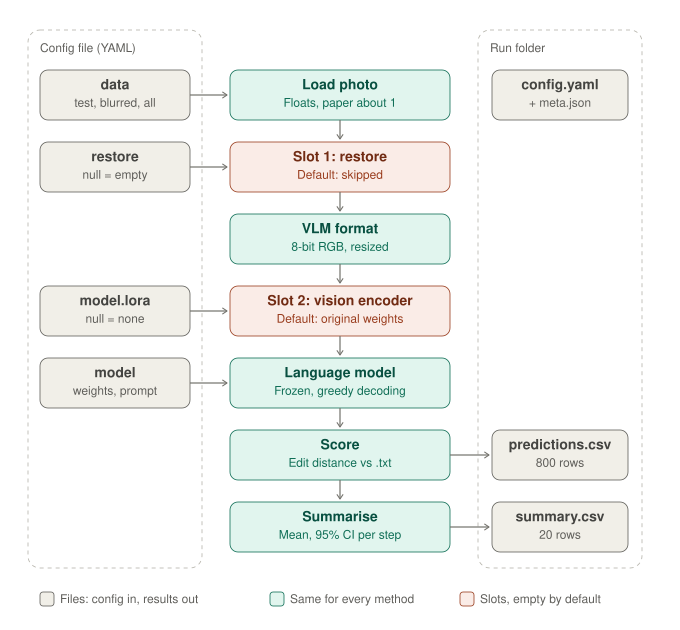

# Pipeline

Every method is evaluated by the same pipeline. A config file chooses the data and fills two slots; everything else stays the same, so the results of all methods can be compared directly.



## Steps

1. **Load photo.** Read the chosen photographs (by default all 800 test pairs, blurred camera) as floating-point images scaled so that the white paper is about 1.
2. **Slot 1: restore.** Optional image processing before the VLM, for example deconvolution. Empty by default.
3. **VLM format.** Convert to an 8-bit RGB image and shrink it to a long side of 1024 pixels.
4. **Slot 2: vision encoder.** Qwen2-VL-2B's vision encoder, optionally with a LoRA adapter. Original weights by default.
5. **Language model.** Qwen2-VL-2B's language model, always frozen, writes the transcription with greedy decoding.
6. **Score.** Compare the transcription with the ground truth (`evaluation.md`).
7. **Summarise.** Average the scores of each defocus step, with a 95% confidence interval.

## How each method uses the slots

| Method | Slot 1: restore | Slot 2: vision encoder |
|---|---|---|
| (a) baseline | empty | original |
| Sharp reference | empty, but the config reads the sharp camera | original |
| (b) deconvolution, estimated PSF | deconvolution with the estimated PSF | original |
| Calibrated-PSF reference | deconvolution with the calibrated PSF | original |
| (c) VLM adaptation | empty | with the trained LoRA adapter |
| (d) learnable deconvolution | trained Wiener filter with the estimated PSF | original |

Methods (c) and (d) are first trained on the training set by separate training scripts. Training produces a small file (the LoRA adapter, or the filter's parameters), which the config then loads into the slot.

## Config

One YAML file per experiment in `configs/`. The main entries:

```yaml
name: baseline_a
model:
  path: models/Qwen2-VL-2B-Instruct   # relative to DEFOCUS_ROOT
  lora: null                          # slot 2
restore: null                         # slot 1, e.g. {name: wiener, ...}
data:
  split: test
  camera: blurred                     # or sharp
  steps: null                         # null = all 20
```

## Running

```bash
sbatch -J baseline_a -o ~/csc2529/logs/%x_%j.out slurm/gpu.sbatch scripts/evaluate.py configs/baseline_a.yaml
```

Each run writes a new folder `$DEFOCUS_ROOT/runs/<name>_<time>/`:

| File | Content |
|---|---|
| `config.yaml` | the config used |
| `meta.json` | start time, machine, Slurm job, git commit and whether the code had uncommitted changes |
| `predictions.csv` | one row per image: step, font, file, ground truth, prediction, score |
| `summary.csv` | one row per step: number of images, mean score, confidence interval |

## Final results

Run folders stay in `$DEFOCUS_ROOT/runs/` and are not committed; there are many of them while a method is being tuned. The final test-set run of each method is copied, as a whole folder, into the repository as `assets/results/<config name>/` (for example `assets/results/baseline_a/`). If a final run is redone, its folder is replaced. Curves, tables and error analysis for the report are made from `assets/results/` only.
